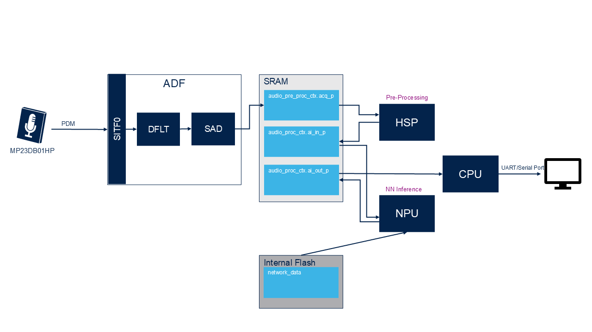

# Application overview

`SITF0`: Digital Serial Interface\
`DFLT`: Digital Filter\
`SAD`: Sound Activity Detector\
`HSP`: Hardware signal processor is a dedicated signal processor engine.\
`CPU`: Cortex M7
`NPU`: Neural Processing Unit (Neural-ART accelerator) accelerate the inference execution of a wide range of quantized convolutional neural network (CNN) models.
