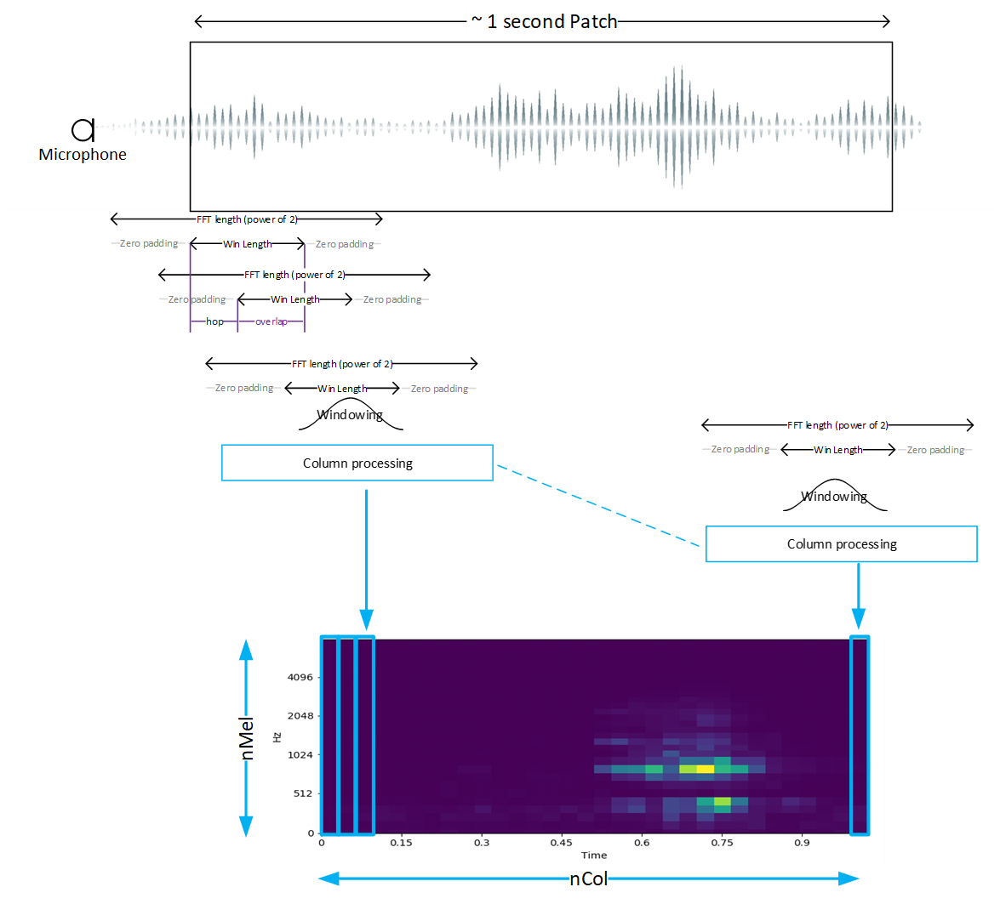

# Deploy your tflite Model on STM32H7P5I-DK

This documentation is an example on how to deploy your own yamnet Audio Event Detection tflite model. The model of this example is a yamnet_256_64x96_tl_int8_5_classes. Please adapt it to your own model/use case.
In order to run your own model you need to follow these steps:

- [1. Generate c-model from tflite model](#1-generate-c-model-from-tflite-model)
- [2. Provide NN Information](#2-provide-nn-information)
- [3. Build \& Run Application](#3-build--run-application)


## 1. Generate c-model from tflite model

In order to generate the [model/network.c](../model/network.c) you must install STEdgeAI as well as IAR EWARM v9.60.3.

1. Add `/c/\<InstallFolder>/Utilities/windows/` in your path to have stedgeai known by your bash.

2. Put you tflite model in the `model` folder.

```bash
#!/bin/bash
cd model
stedgeai generate -m yamnet_256_64x96_tl_int8_5_classes.tflite --target stm32h7 --st-neural-art default-h7@profiles.json
cp st_ai_output/network.h .
cp st_ai_output/network.c .
cp st_ai_output/stai_network.h .
cp st_ai_output/stai_network.c .
cp st_ai_output/network_sysmem.eFlash2.c network_data.c
cp st_ai_output/network_ecblobs.h .
```

You can find the following script at [model/generate-h7p-model.sh](../model/generate-h7p-model.sh)

## 2. Provide NN Information

You need to edit the last lines of [ai_model_config.h](../Projects/STM32H7P5I-DK/application/audioPipeline/ai_model_config.h) to make the app compatible with your network.


```C
#define CTRL_X_CUBE_AI_MODEL_NB_OUTPUT         (1U)
#define CTRL_X_CUBE_AI_MODEL_OUTPUT_1          (CTRL_AI_CLASS_DISTRIBUTION)
```

Then you describe the class indexes and their labels in this way:

```C
#define CTRL_X_CUBE_AI_MODEL_CLASS_NUMBER        (5U)
#define CTRL_X_CUBE_AI_MODEL_CLASS_LIST          {"chirping_birds","clapping",\
                                                  "crying_baby","dog","rooster"}
```

Now you can select audio preprocessing type:

```C
#define CTRL_X_CUBE_AI_PREPROC                 (CTRL_AI_SPECTROGRAM_LOG_MEL)
```

For spectrogram log mel pre processing you can specify the various parameters of
the patch processing:



The parameters are:

```C
#define CTRL_X_CUBE_AI_SPECTROGRAM_NMEL          (64U)
#define CTRL_X_CUBE_AI_SPECTROGRAM_COL           (96U)
#define CTRL_X_CUBE_AI_SPECTROGRAM_HOP_LENGTH    (160U)
#define CTRL_X_CUBE_AI_SPECTROGRAM_NFFT          (512U)
#define CTRL_X_CUBE_AI_SPECTROGRAM_WINDOW_LENGTH (400U)
#define CTRL_X_CUBE_AI_SPECTROGRAM_NORMALIZE     (0U)
#define CTRL_X_CUBE_AI_SPECTROGRAM_FORMULA       (MEL_HTK)
#define CTRL_X_CUBE_AI_SPECTROGRAM_FMIN          (125U)
#define CTRL_X_CUBE_AI_SPECTROGRAM_FMAX          (7500U)
#define CTRL_X_CUBE_AI_SPECTROGRAM_TYPE          (SPECTRUM_TYPE_MAGNITUDE)
#define CTRL_X_CUBE_AI_SPECTROGRAM_LOG_FORMULA   (LOGMELSPECTROGRAM_SCALE_LOG)
```

For optimizing Mel Spectrogram computational performances the following *L*ook
*U*p *T*ables (*LUT*) needs to be provided:

- the smoothing window to be applied before the Fast Fourrier transform , this
is typically an Hanning window the table is named with the following defines:

```C
#define CTRL_X_CUBE_AI_SPECTROGRAM_WIN           (user_win)
```

- the Mel filters taps. Only non nul taps are provided in a concatenated form,
which is why start and stop indexes are provided in separated tables

```C
#define CTRL_X_CUBE_AI_SPECTROGRAM_MEL_LUT       (user_melFiltersLut)
#define CTRL_X_CUBE_AI_SPECTROGRAM_MEL_START_IDX (user_melFilterStartIndices)
#define CTRL_X_CUBE_AI_SPECTROGRAM_MEL_STOP_IDX  (user_melFilterStopIndices)
```

Typically, *LUT*s can be generated by the ST model zoo deployment script.
Alternatively python scripts are provided in
`<getting-start-install-dir>/Utils/GenHeader`.

These *LUT*s are defined in
`Projects/STM32H7P5I-DK/application/audioPipeline/Src/user_mel_tables.c` and declared in
`Projects/STM32H7P5I-DK/application/audioPipeline/Inc/user_mel_tables.h`

You will now describe the digital microphone that will connect to the AI
processing chain:

```C
#define CTRL_X_CUBE_AI_SENSOR_TYPE            (COM_TYPE_MIC)
#define CTRL_X_CUBE_AI_SENSOR_ODR             (16000.0F)
```

## 3. Build & Run Application

Once the network is built (step 1) and network details configured (step 2) you can build your application following this guide:

[Application build and run](../README.md#application-build-and-run)
