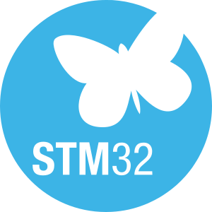
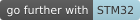

# Audio Event Detection Getting Started

This project provides a real-time embedded environment for STM32H7P series
microcontroller to execute
[STEdgeAI](https://www.st.com/en/development-tools/stedgeai-core.html) generated
models. It is a bare-metal application for the STM32H7P5I-DK that recognizes 
five audio events in real time. The application uses the integrated microphone,
HSP for audio preprocessing, and the Neural-ART target for AI inference.

The project uses the `yamnet_256_64x96_tl_int8_5_classes.tflite` model and
recognizes the following classes:

- chirping birds
- clapping
- crying baby
- dog
- rooster

## Hardware Support

- STM32H7P5I-DK board
- MP23DB01HP MEMS microphone integrated on the board
- ST7315 OLED display for pictograms
- USB-UART connection for runtime traces

## Software Environment

- [STM32CubeIDE for Visual Studio Code](https://marketplace.visualstudio.com/items?itemName=stmicroelectronics.stm32-vscode-extension)
  - ARM GCC toolchain 14.3.1
  - CMake 4.4.0
  - Ninja 1.13.2
- [STM32CubeProgrammer](https://www.st.com/en/development-tools/stm32cubeprog.html) (__v2.23.0__)
- [STEdgeAI](https://www.st.com/en/development-tools/stedgeai-core.html) (__v4.1.0__)

## Quickstart Using Prebuilt Binary

1. Power on the board and connect it to your PC via USB.
2. Open STM32CubeProgrammer and connect to the board.
3. Load the prebuilt binary file located in the `binary` folder.
4. Press NRST button on the board to start the application.
5. The application will start, and you should see the audio event detection
 output on the console and on the OLED display.

## CMake Build and Flash

The repository currently provides one configure/build preset:

- `debug_GCC_STM32H7P5I-DK`

From the repository root, enter the board project directory and configure/build: 

```bash
cd STM32H7P5I-DK
cmake --preset debug_GCC_STM32H7P5I-DK -DAPP_LCD=ON
cmake --build --preset debug_GCC_STM32H7P5I-DK
```

LCD support is disabled by default. To include the OLED driver and pictograms
add `-DAPP_LCD=ON` to the CMake configure command.

The generated executable and linker map are:

```text
STM32H7P5I-DK/build/debug_GCC_STM32H7P5I-DK/STM32H7P-GettingStarted-AED.elf
STM32H7P5I-DK/build/debug_GCC_STM32H7P5I-DK/STM32H7P-GettingStarted-AED.map
```

The application enables `USE_HSP` to accelerate audio preprocessing and
`USE_TRACE=1` makes `PRINTF` send traces to the console.

To flash the generated binary onto the STM32H7P5I-DK board, use the
STM32CubeProgrammer:

```bash
STM32_Programmer_CLI -c port=SWD -w build/debug_GCC_STM32H7P5I-DK/STM32H7P-GettingStarted-AED.elf
```
Reset the board using the reset button to start the application.

##  Model Generation

The source model is stored in `model/yamnet_256_64x96_tl_int8_5_classes.tflite`.
The script `model/generate-h7p-model.sh` invokes ST Edge AI Core 4.1 with the
`default-h7@profiles.json` Neural-ART profile and the `stm32h7` target. The
script currently expects the Windows installation at
`C:/ST/STEdgeAI/4.1/Utilities/windows/stedgeai.exe`; update that path in the
script if the tool is installed elsewhere.

Run the script from the `model/` directory using Git Bash or another Bash
environment. ST Edge AI writes its generated output to `model/st_ai_output/`.
The generated network sources used by this project are maintained in
`application/ai/` and must be updated consistently when replacing the model.

##  How to update my project with a new version of ST Edge AI

The neural network model files (`network.c/h`, `stai_network.c/h`, etc.) 
included in this project were generated using
[STEdgeAI](https://www.st.com/en/development-tools/stedgeai-core.html) version
4.1.0.

Using a different version of STEdgeAI to generate these model files may result
in the following compile-time error: `Possible mismatch in ll_aton library used`.

If you encounter this error, please follow the STEdgeAI instructions on
[How to update my project with a new version of ST Edge AI Core](https://stedgeai-dc.st.com/assets/embedded-docs/stneuralart_faqs_update_version.html) to update your project.

## Troubleshooting

[](https://dev.st.com/stm32cube-docs/examples/arch-v1/en/debug/debug_toc.html "An offline version is also available in the STM32Cube firmware package.")

- _No detection messages:_ Make sure the input source is audible to the onboard
  microphone and produces enough signal to pass the configured silence threshold.
- _The LED flashes:_ The ADF interrupt reported an error. Check the ADF clock, microphone
  bitstream, DMA channel assignment, and interrupt wiring in the generated project.
- _No console messages:_ Build with `USE_TRACE=1` and connect to `LPUART1` using
  the settings in [UART Console](#52-uart-console).

## See Also

[](https://dev.st.com/stm32cube-docs/examples/arch-v1/en/more/more_toc.html "An offline version is also available in the STM32Cube firmware package.")

- [How to build and run with STM32CubeIDE for Visual Studio Code](doc/how-to-build-and-run-with-cube.md)
- [Application Overview](doc/application-overview.md)
- [Deploy a TFLite model](doc/Deploy-your-tflite-Model-STM32H7P5I-DK.md)

## License

Copyright (c) 2026 STMicroelectronics.

This software is licensed under terms that can be found in the LICENSE file in the root directory
of this software component. If no LICENSE file comes with it, it is provided AS-IS.
