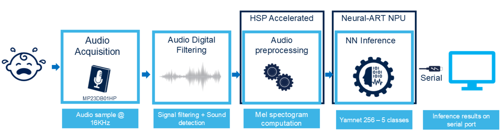

# Audio Event Detection Getting Started

This project provides a real-time embedded environment for STM32H7P microcontroller to execute
 [ST Edge AI](https://www.st.com/en/development-tools/stedgeai-core.html)
generated model targetting audio event detection applications. The purpose of this package is to
stream physical data acquired by sensors into a processing chain including a
preprocessing step that typically would perform a first level of feature
extraction, the machine learning inference itself before exposing the results
to the user in real time through a serial console.
The project implements only a bare metal version.



## Table of Contents

- [Hardware and Software environment](#hardware-and-software-environment)
  - [Hardware support](#hardware-support)
  - [Toolchains support](#toolchains-support)
- [Quickstart using prebuilt binaries](#quickstart-using-prebuilt-binaries)
- [Application Build and Run](#application-build-and-run)
  - [IAR EWARM](#iar-ewarm)
- [Serial Console](#serial-console)
  - [Serial port configuration](#serial-port-configuration)
- [Configuration](#configuration)
  - [Application configuration](#application-configuration)
  - [AI Model](#ai-model)

**Documentation Folder:**

- [Application Overview](Doc/Application-Overview.md)
- [Deploy-your-tflite-Model-STM32H7P5I-DK.md](Doc/Deploy-your-tflite-Model-STM32H7P5I-DK.md)

## Hardware and Software environment

### Hardware support

- STM32H7P5I-DK Nucleo board
  - MEMS audio sensor [MP23DB01HP](https://www.st.com/en/mems-and-sensors/mp23db01hp.html#overview) directly in the board.

### Toolchains support

- STM32CubeProgrammer v0.0.0-H7P-B01
- IAR Embedded Workbench for Arm (**EWARM 9.60.3**) + H7P patch
(EWARMv9_STM32H7Pxx_2.5)
- STEdgeAI (**v3.2.0-A6-stm32h7p-stm32v8**)

## Quickstart using prebuilt binaries

One use case is provided:

- Audio Event Detection (aed): Automatically recognizing events like a baby
  crying or a clapping.

To program the board's internal flash using command lines:

  1. Install STM32 Programmer in your system.
  2. Add `STM32_Programmer_CLI` to your PATH.
  3. Program the board with
    `STM32_Programmer_CLI -c port=swd -w Binary/STM32H7P5I-DK_STM32H7P-GettingStarted-AED.hex`
  4. Power cycle the board

Note: You can as well use STM32CubeProgrammer with the GUI.

Start the application by pressing the reset button on the board.

## Application Build and Run

### IAR EWARM

Double-click `Projects/STM32H7P5I-DK/EWARM/STM32H7P-GettingStarted-AED.eww` to open the project in IAR. Build and run the project.

---

## Serial Console

### Serial port configuration

This application outputs results and useful information (depending on the configured
level of verbosity) through a serial connection. The default configuration of
the serial link is:

- Speed = 115200 bauds
- Data = 8 bit
- Parity = None
- Stop bit = 1 bit
- Flow control = none

The application will start sending logs to the console through the USB cable to the PC serial
console (you may choose [Teraterm](https://teratermproject.github.io/index-en.html)).

The welcome screen will display the system configuration and the status of the
inference processing:

```Terminal
---------------------------------------------------------------
        System configuration (Bare Metal)
---------------------------------------------------------------

Log Level: Info

Compiled with IAR 9 (build 422)
STM32 device configuration...
 Device       : DevID:0x047b (STM32H7Pxx) RevID:0x0000
 Core Arch.   : M7 - FPU  used
 HAL version  : 0x02000000
 SYSCLK clock : 400 MHz
 HCLK clock   : 200 MHz


HSP Acceleration used for Preprocessing

---------------------------------------------------------------


ST.AI RT
---------------------------------------------------------------
 tools version   : v3.2.0
 network rt lib  : v1.1.2-7112010f
   compiled with : IAR 9 (build 422)

AI_AUDIOPIPELINE: Activation are already allocated
Network informations...
 model signature :
 c-name          : network
 c-signature     : 0
 c-datetime      : 2025-11-07 15:45:29
 c-compile-time  : Nov 12 2025 15:06:53
 macc            : 0
 runtime version : 1.1.2
 n_inputs : 1 (allocate-inputs)
  i[0]  name=Input_0_out_0 (1,96,64,1) i8(7.0) (fmt=0x00840440) @0x2FFB0000/6144
        scale=0.058037 zeropoint=31
 n_outputs : 1 (allocate-outputs)
  o[0]  name=Dequantize_59_out_0 (1,5) float32 (fmt=0x00821040) @0x2FFB0410/20
 n_activations : 18 (allocate-activations)
  a[0]  i8(7.0) @0x2FFB0000/6144
  a[1]  u8(8.0) @0x2FFB1800/49152
  a[2]  u8(8.0) @0x2FFF0000/49152
  a[3]  u8(8.0) @0x2FFB0000/98304
  a[4]  u8(8.0) @0x2FFC8000/24576
  a[5]  u8(8.0) @0x2FFB0000/49152
  a[6]  u8(8.0) @0x2FFBC000/49152
  a[7]  u8(8.0) @0x2FFB0000/49152
  a[8]  u8(8.0) @0x2FFBC000/12288
  a[9]  u8(8.0) @0x2FFB0000/24576
  a[10]  u8(8.0) @0x2FFB6000/24576
  a[11]  i16(0.15) @0x2FFBC000/49152
  a[12]  i8(7.0) @0x2FFB0000/24576
  a[13]  u8(8.0) @0x2FFB6000/256
  a[14]  i8(7.0) @0x2FFB0410/5
  a[15]  i8(7.0) @0x2FFB0410/5
  a[16]  i8(7.0) @0x2FFB0430/5
  a[17]  i32(31.0) @0x2FFB0000/1028
 n_states : 0
 n_weights : 0
MEL spectrogram 64 mel x 96 col
- sampling freq : 16000 Hz
- acq period    : 960 ms
- window length : 400 samples
- hop length    : 160 samples
Free BRAM DEFAULT : 2282
Free BRAM PERSISTENT : 4096

---------------------------------------------------------------
# Start Processing
---------------------------------------------------------------
| Vu meter          | Time(s) |  Cpu  |  Pre  |  AI   | Post  |
                    | 1       |  0.00%|  0.00%|  0.00%|  0.00%|
```

When the signal level is above a certain threshold, the following types of audio
events can be detected:

- chirping_birds
- clapping
- crying_baby
- dog
- rooster

You can play sound samples corresponding to these events to test the system.

Various useful information are displayed on the console such as cpu spent for AI
infering or preprocessing.
A small "Vu Meter" is provided to visualize the audio input level.

The latest detected class is shown along with the time stamp and the probability
of each class is also shown, in a blind way, without class labels.

```Terminal

---------------------------------------------------------------
# Start Processing
---------------------------------------------------------------
| Vu meter          | Time(s) |  Cpu  |  Pre  |  AI   | Post  |
                    | 92      | 13.01%|  1.53%| 11.47%|  0.00%|

               "clapping" detected after 92 s
---------------------------------------------------------------
 0 97  0  1  0
```

Once you have verified the system is working as expected, you can stop the
application by hitting any key on the console and check real time statistics.

```Terminal
---------------------------------------------------------------
# Stop Processing
---------------------------------------------------------------

                       CPU timing summary
---------------------------------------------------------------
| Statistics                  | Pre-Processing | AI inference |
---------------------------------------------------------------
| Number of call              |              26|            13|
| Average (ms)                |            7.77|          6.05|
| Relative load (%)           |            0.54|          0.21|
---------------------------------------------------------------
```

## Configuration

The user has the possibility to override the default application configuration
by modifying  `Projects/STM32H7P5I-DK/application/core/app_config.h`, and the
AI model by modifying `Projects/STM32H7P5I-DK/application/audioPipeline/Inc/ai_model_config.h`.

### Application configuration

In  `Projects/STM32H7P5I-DK/application/core/app_config.h`,you can change
the default verbosity of the application by setting the `LOG_LEVEL`:

```C
#define LOG_LEVEL LOG_INFO
```

You migth also want to adapt the serial link baud rate:

```C
#define USE_UART_BAUDRATE 115200
```

### AI Model

The example provided below is based on Yamnet 256 model provided in the
[ST model zoo](https://github.com/STMicroelectronics/stm32ai-modelzoo).

You can change the model used in this application. You can follow this document: [Doc/Deploy-your-tflite-Model-STM32H7P5I-DK.md](Doc/Deploy-your-tflite-Model-STM32H7P5I-DK.md)

