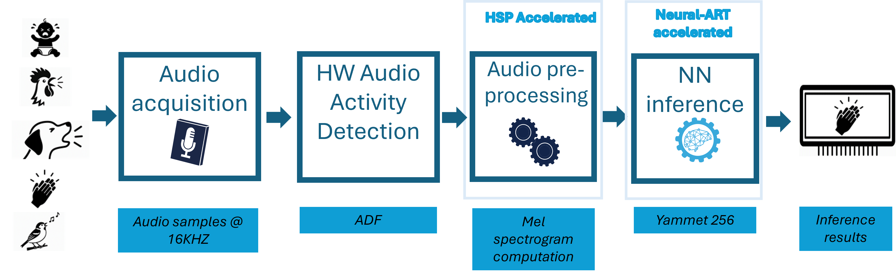

# Application overview


The main loop is implemented in `STM32H7P5I-DK/main.c`. It calls `app_init()`, repeatedly
calls `app_process()` until processing stops, and then calls `app_deinit()`.

The application:

1. initializes the LPUART console, AI model, and audio preprocessing (and the
   OLED when configured with `APP_LCD=ON`);
2. starts ADF audio acquisition using DMA and the sound-activity detector;
3. generates a 64-band, 96-column log-Mel spectrogram;
4. runs inference when the spectrogram sum exceeds `AI_SPECT_SILENCE_THR`;
5. reports the detected class or an unknown result on the console, and displays
   it on the OLED when configured with `APP_LCD=ON`;
6. stops processing when any byte is received on `LPUART1`.

###  Typical Output on UART Console

```text
-----------------------------------------
    System configuration (Bare Metal)
-----------------------------------------
STM32H7P-GettingStarted-AED 1.0.0 ()
Build date & time: Oct 13 2026 11:23:53
Compiler: GCC 14.3.1
HAL: 2.0.0
STEdgeAI Tools: 4.1.0
NN model: yamnet_256_64x96_tl_int8_5_classes
-----------------------------------------

STM32 device configuration...
 Device       : DevID:0x047b (STM32H7Pxx)
 Core Arch.   : M7 - FPU  used
 SYSCLK clock : 520 MHz
 HCLK clock   : 260 MHz
 CACHE conf.  : $I/$D=(True,True)

-----------------------------------------

HSP Acceleration used for Preprocessing
MEL spectrogram 64 mel x 96 col
- window length : 400 samples
- hop length    : 160 samples
Audio acquisition
- sampling freq : 16000 Hz
- acq period    : 960 ms

-----------------------------------------
# Start Processing
-----------------------------------------
| Time(seconds) |  Cpu  |  Pre  |  AI   |
-----------------------------------------
|       38      |  1.12%|  0.62%|  0.50%|

"clapping" (93 %) detected after 37 s

```

The application stops when any byte is received on `LPUART1`.

```text
-----------------------------------------
# Stop Processing
-----------------------------------------

          CPU timing summary
-----------------------------------------
| Statistics        | Pre-Proc | AI     |
-----------------------------------------
| Number of call    |       15|       14|
| Average (ms)      |     5.75|     4.63|
| Relative load (%) |     0.08|     0.06|
-----------------------------------------
```

As per CPU timing summary, the preprocessing (5.75 ms) and AI inference (4.63 ms)
inference times are minimal, indicating efficient utilization of the available
processing resources (HSP and NPU Hardware acceleration).

## Configuration

[](https://dev.st.com/stm32cube-docs/examples/arch-v1/en/configure/config_toc.html "An offline version is also available in the STM32Cube firmware package.")

The main configuration files are:

- `application/app_config.h`: trace settings, display periods, and silence threshold;
- `application/dpu/ai_model_config.h`: spectrogram parameters;
- `application/dpu/dpu_config.h`: DPU configuration values;
- `application/CMakeLists.txt`: application sources, include directories, and compile definitions;
- `STM32H7P5I-DK/CMakePresets.json`: the available CMake configure and build presets.

The preprocessing context is defined in `application/dpu/preproc_dpu.h`. The
generated model and its interface are located in `application/ai/`. Generated
files should not be edited manually.

##  Application Parameters

The current audio-processing parameters are:

| Parameter | Value |
| --- | ---: |
| Sampling rate | 16000 Hz |
| Mel bands | 64 |
| Columns | 96 |
| Window length | 400 samples |
| Hop length | 160 samples |
| FFT length | 512 |
| Mel frequency range | 125 to 7500 Hz |
| Spectrum type | Magnitude |
| Normalization | Disabled |
| Acquisition duration | 960 ms |
| Silence threshold | 2500 |
| Detection confidence threshold | 0.8 |

The model accepts one int8 input tensor of shape `1 x 96 x 64 x 1` (6144
bytes), with scale `0.0580373295` and zero-point `31`. It produces one float32
output tensor of shape `1 x 5` (20 bytes).

##  UART Console

Runtime traces are emitted through the `PRINTF` macro defined in
`application/app_config.h` and are routed through `LPUART1` on PA2/PA3.
The generated peripheral configuration uses:

| Setting | Value |
| --- | ---: |
| Baud rate | 115200 |
| Data bits | 8 |
| Parity | None |
| Stop bits | 1 |
| Flow control | None |

Send any character to stop the processing loop.

