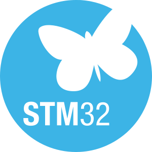
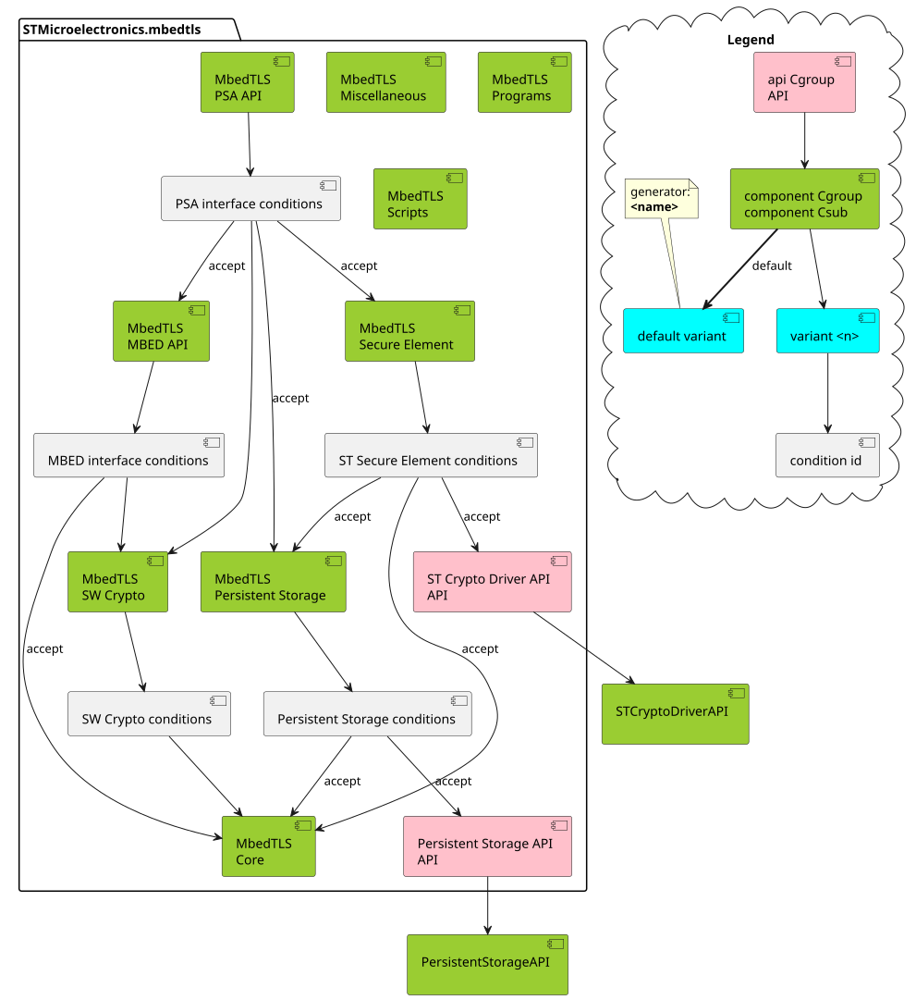

<!--
  ******************************************************************************
  * @file    ST_README.md
  * @brief   Annotation of the README for Mbed TLS by STMicrolectronics
  ******************************************************************************
  * @attention
  *
  * Copyright (c) 2025 STMicroelectronics.
  * All rights reserved.
  * Copyright The Mbed TLS Contributors
  *
  * This software is licensed under terms that can be found in the LICENSE file
  * in the root directory of this software component.
  * If no LICENSE file comes with this software, it is provided AS-IS.
  *
  ******************************************************************************
-->

# __Middleware: *mbedtls*__

This pack is a STMicroelectronics initiative to split the [Mbed TLS library](https://www.trustedfirmware.org/projects/mbed-tls/) into software components.

## __1. Abstract__

It is a software pack that contains only software components that deal with cryptography, the TLS implementation, and sockets references.

## __2. ST Changelog__

Main ST changes: From Mbed TLS 3.6.4
  * Add <CODE_OF_CONDUCT.md>
  * Rework ReadMe:
    1. Rename <README.md> to <MBEDTLS_README.md>
    2. Add <README.md> as a router, by STMicroelectronics
    3. Create <ST_README.md>
  * Remove dual license, STMicroelectronics provides the Mbed TLS middleware
    under only the Apache-2.0 license
  * Reformat the license file to Markdown and generate an HTML
  * Replace the Mbed TLS contribution file with the ST contribution file
  * Replace the Mbed TLS security file with the ST security file (PSIRT)
  * Add HUK feature to allow cipher operation using the hardware unique key on STM32
  * Set `MBEDTLS_PRIVATE` for pk in `mbedtls_pk_get_ec_group_id`
  * Enable constant time API to be used by RSA Alt in `constant_time` files
  * Add double signature check, with single signature computation in <ecdsa.c> file
  * Improve self-test for nist_kw and gcm:
    * <gcm.c> & <nist_kw.c>: improved Mbed TLS self-test to skip the AES-192 key size
    test when the alternative implementation does not support it
  * Add "ITS PSA driver" support in <psa_crypto_storage.c> file

Fix:
  * Miscellaneous warnings (including those raised by IAR and Arm® Keil® toolchains).
    * `IAR Warning[Pe546]`: transfer of control bypasses the initialization
    variable : padding
    * <psa_crypto_aead.c> & <pas_crypto_driver_wrappers.c>:
    add `MBEDTLS_PSA_BUILTIN_AEAD` flag to avoid `Keil Error: L6218E: Undefined
    symbol`
    * <psa_crypto.c>: Add `AT_LEAST_ONE_BUILTIN_KDF` flag to avoid `IAR
    Warning[Pe111]`
    * <pkcs5.c> : moved padding variable declaration to the beginning of
    `mbedtls_pkcs5_pbes2_ext()` to avoid IAR warning
    * <ssl_misc.h>: Cast ssl state to mbedtls_ssl_states in handshake increment
    function `IAR Warning[Pe188]: enumerated type mixed with another type`
  * Warning in <pk.c> : 'key_bits' may be used uninitialized
  * Enumerated type mixed with another type (mbedtls_md_type_t)
  * Double inclusion path porting on <crypto.h>:
    * Add `MBEDTLS_RSA_C` in <psa_crypto_driver_wrappers.h> file
    * Add `MBEDTLS_MD_C` in <md.c> and <config_adjust_psa_from_legacy.h> files
    * Add `AT_LEAST_ONE_BUILTIN_KDF`, `PSA_WANT_ALG_GCM`, and `PSA_WANT_ALG_CCM` to <psa_crypto.c> file
    * Add `MBEDTLS_PK_HAVE_ECC_KEYS` to <pk.c> file
  * <pkparse.c> fix warning when `MBEDTLS_PEM_PARSE_C`, `MBEDTLS_PKCS12_C`, and `MBEDTLS_PKCS5_C` are not defined

Customizations:
  * Support STM32 Key Wrap Engine (KWE):
    * Add KWE opaque driver to Mbed TLS and improve Jinja driver templates
    * Export `rsa_rsassa_pkcs1_v15_encode()` and `mgf_mask()` functions to be used by Key Wrap Engine PSA driver
  * Replace include psa/error by mbedtls/error in <psa_crypto_se.c> and <psa_crypto_storage.c> files
  * Allow creating a read-only key (for Secure Element)
  * Using of vendor keys (for Secure Element)
  * Support Hardware Unique Key (HUK), under switch `USE_HUK`

Temporary changes for TF-M 1.3.0:
  * Remove unsupported functions: `psa_mac_compute()`, `psa_mac_verify()`, `psa_cipher_encrypt()`, `psa_cipher_decrypt()`
  * Use deprecating define `PSA_KEY_USAGE_SIGN_HASH` (instead of `PSA_KEY_USAGE_SIGN_MESSAGE`)
  * Use deprecating define `PSA_KEY_USAGE_VERIFY_HASH` (instead of `PSA_KEY_USAGE_VERIFY_MESSAGE`)
  * Fix switch `MCUBOOT_DOUBLE_SIGN_VERIF` name
  * Exclude macro when building project for TFM to avoid Warning[Pa181]:
      incompatible redefinition of macros : `PSA_KEY_EXPORT_MAX_SIZE`,
      `PSA_MAX_BLOCK_CIPHER_BLOCK_SIZE`, `PSA_HASH_SIZE`, `PSA_MAC_FINAL_SIZE`
      & `PSA_ALG_TLS12_PSK_TO_MS_MAX_PSK_LEN`
  * Add in <crypto_spe.h>: function definition to avoid duplication of symbols
      between TF-M and Mbed TLS

## __3. Package structure overview__

### __3.1. Mbed TLS Framework__

This framework is built around applications of cryptographic and storage as described below:

Main features:
* Cryptographic algorithms and operations with transparent and/or opaque keys
* Access to storage
* Access to miscellaneous crypto drivers
* Useful for TLS communications

It offers two high level interfaces to be used by examples and user applications:
* PSA Cryptography API (the standard): by Arm, see [Platform Security Architecture](https://arm-software.github.io/psa-api/).
* Mbed TLS API (deprecated): Native interface, useful for TLS mainly.

The middleware may be optionally augmented with additional elements out of this pack:
* Dynamic connection to Secure Element (vendor keys)
* Persistent keys storage
* ALTernative cryptographic implementations (hardware and/or software)

### __3.2. High level APIs__

The high level has two exclusive categories of services through the following APIs:

  * __Standardized PSA API__: For cryptographic and key management operations, such as:
    - Importing keys (transparent mode)
    - Storing keys persistently
    - Using opaque keys by identifier
    - Accessing crypto drivers

  * __Legacy Mbed TLS API__: For cryptographic operations with cleartext keys and additional features, including TLS support.

The cryptography library in Mbed TLS is a reference implementation of the cryptography interface of the PSA.

### __3.3. Internal structure__

The pack description is proposed with the following components:

* Core component:
It is a foundation component that realizes common operations: memory allocation, data decoding, big numbers arithmetic, debug, constant time functions.

* Crypto component:
It contains software implementations from Mbed™ Crypto.

* Persistent storage component:
It deals with provisioned and/or runtime imported keys that are stored into persistent objects.
Some keys can have predefined identifiers and may be dedicated to a Secure Element.

* Secure Element component:
It deals with external secure cryptoprocessors.

### __3.4. Low-level interface__

The low-level interface is optional. It is required according to the level of the selection of implementation.

It comes with elements defined in [CMSIS APIs](https://open-cmsis-pack.github.io/Open-CMSIS-Pack-Spec/main/html/pdsc_apis_pg.html), the implementations of which are defined out of this pack.

These implementations of crypto alternative or crypto drivers can be supported and worked concurrently on the PSA driver API. A unique storage implementation shall exist on ITS.

Consequently, the solution is scalable and can be augmented with other packs for:
* Dynamic connection to Secure Element (vendor keys)
* Persistent keys storage

## __4. Configuration__

Mbed TLS is delivered with a template (<mbedtls_config.h> file) listing all available options.
This is the reference file used to customize configuration and identify deprecated or new options in the version.
This template can be used as an input to generate parameters in the user interface.

The configuration with STM32CubeMX2 is possible thanks to STM32 Flexible Crypto Framework (STFCF)
middleware, several options, implementations, and setup personalized configuration are provided.

As a beginner, the user can use the default or a predefined configuration.
As an expert, the user can customize a new configuration.

Whatever the level, generated files (<mx_stfcf_config.h> that includes <mx_mbedtls_config.h>) are installed at the application user space.
These files are selected within the toolchain suite by setting a preprocessor flag: MBEDTLS_CONFIG_FILE

Further information is available on the [Mbed TLS](https://www.trustedfirmware.org/projects/mbed-tls) website.

## __5. Code Structure__

**Software Architecture**

The pack is architected as depicted in the [UML diagram](https://www.uml-diagrams.org/uml-25-diagrams.html) below.

Open-CMSIS-Pack components model

The [Open-CMSIS-Pack](https://www.open-cmsis-pack.org/) components are organized as follows:

> **_NOTE:_** Some components are not delivered in this Open-CMSIS-Pack. \
They are indicated out of the [package](https://www.uml-diagrams.org/package-diagrams.html#package) of this middleware in the diagram.

## __6. Troubleshooting__

Refer to the [CONTRIBUTING.md](CONTRIBUTING.md) guide.

### __6.1. Debug Toolbox__

Refer to the [STM32 debug toolbox](https://www.st.com/resource/en/application_note/an4989-stm32-microcontroller-debug-toolbox-stmicroelectronics.pdf) for further information about how to troubleshoot the problem.

### __6.2. Asking for support__

You can find information on how to use this community [here](https://community.st.com/s/community-overview) or refer also to the [`BUGS.md`](BUGS.md) file.
In case you need more support, use [ST Community](https://community.st.com/s/topic/0TO0X000000BSqSWAW/stm32-mcus)
to ask a question in the appropriate category.

## __7. License__

This software is licensed under terms that can be found in the [`LICENSE`](LICENSE.md) file in the root directory of this software component.

## __8. See Also__

More information about the STM32 ecosystem can be found in the [STM32 MCU Developer Zone](https://www.st.com/content/st_com/en/stm32-mcu-developer-zone.html).
